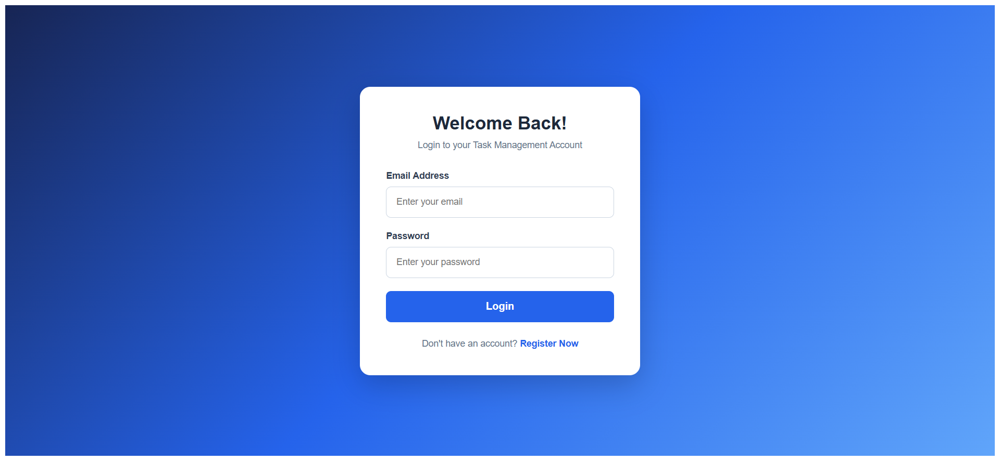
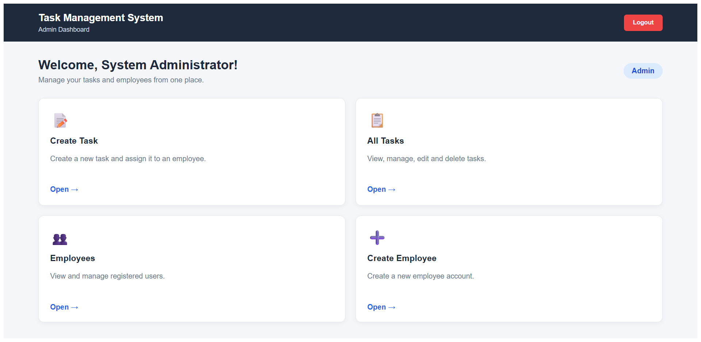
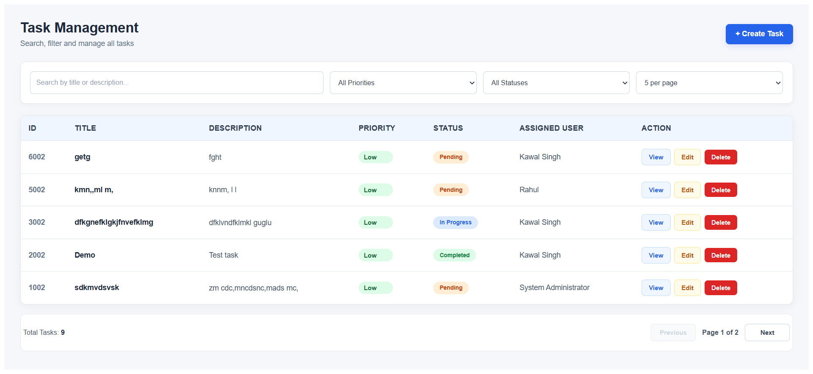
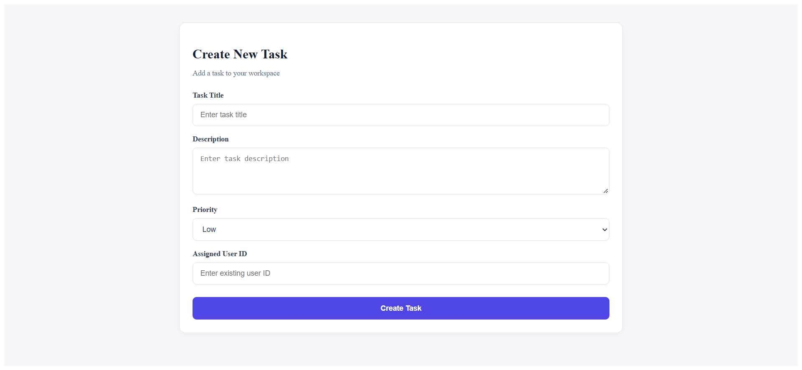

# Task Management System

A full-stack Task Management System built using ASP.NET Core Web API, React.js, Entity Framework Core, and Microsoft SQL Server.

## Features

- JWT-based authentication
- Refresh token generation and revocation
- Role-based authorization
- Employee management
- Task creation, assignment, and status tracking
- Task search, filtering, and pagination
- RESTful APIs
- Swagger / OpenAPI documentation
- Global exception handling

## Technology Stack

| Layer | Technologies |
|---|---|
| Frontend | React.js, JavaScript, HTML5, CSS3, Bootstrap |
| API Communication | Axios |
| Backend | ASP.NET Core Web API, C# |
| ORM | Entity Framework Core, LINQ |
| Authentication | JWT, Refresh Tokens |
| Database | Microsoft SQL Server |
| Documentation | Swagger / OpenAPI |

## Project Structure

```text
Task-Management-System/
├── TaskManagement.API/
├── TaskManagement.Application/
├── TaskManagement.Domain/
├── TaskManagement.Infrastructure/
│   ├── Data/
│   ├── Repositories/
│   ├── Services/
│   └── Migrations/
├── taskmanagement-client/
├── TaskManagementSystem.sln
└── README.md
```

## Prerequisites

- .NET 8 SDK
- Microsoft SQL Server
- Node.js and npm
- Visual Studio 2022 or VS Code
- Git

## Installation and Setup

### 1. Clone the Repository

```bash
git clone https://github.com/Developer-Ajit515/Task-Management-System.git
cd Task-Management-System
```

### 2. Configure the Database

Configure the SQL Server connection string in:

`TaskManagement.API/appsettings.json`

Use your own SQL Server instance and database credentials. Do not commit passwords, JWT secrets, or other sensitive configuration to GitHub.

### 3. Apply Entity Framework Core Migrations

Migrations are maintained in:

`TaskManagement.Infrastructure/Migrations/`

Install EF Core CLI if required:

```bash
dotnet tool install --global dotnet-ef
```

Apply migrations from the repository root:

```bash
dotnet ef database update --project TaskManagement.Infrastructure --startup-project TaskManagement.API
```

### 4. Run the Backend

```bash
dotnet restore
dotnet build
dotnet run --project TaskManagement.API
```

Check the terminal output for the API URL and Swagger endpoint.

### 5. Run the Frontend

Open another terminal:

```bash
cd taskmanagement-client
npm install
npm run dev
```

Open the frontend development URL displayed in the terminal.

Make sure the frontend API configuration points to the running backend.

## Authentication

The application uses JWT authentication to protect API endpoints. Refresh-token functionality supports token renewal and revocation. Role-based authorization controls access to protected resources.

## API Documentation

Swagger / OpenAPI is configured in the ASP.NET Core API project. Start the backend and open the Swagger URL displayed by the application.

## Screenshots

### Login Page


### Dashboard


### Task List


### Create Task


### User List


## Future Improvements

- Automated unit and integration tests
- Postman API collection
- Improved frontend refresh-token handling
- Enhanced employee assignment experience
- Additional reporting and dashboard features
- Deployment configuration

## Author

**Ajit Singh**

- GitHub: https://github.com/Developer-Ajit515
- LinkedIn: https://www.linkedin.com/in/ajit-singh-62836b158/
