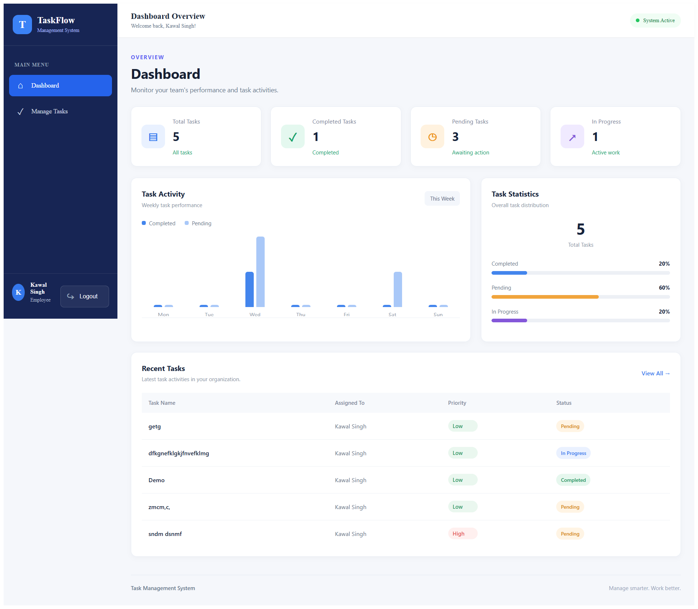

# Task Management System

A full-stack Task Management System built using **ASP.NET Core Web API, React.js, Entity Framework Core, and Microsoft SQL Server**. The application supports JWT authentication, refresh tokens, role-based authorization, employee management, and task management.

## Features

- JWT-based authentication
- Refresh token generation, renewal, and revocation
- Role-based authorization (Admin and Employee)
- Employee management
- Task creation, assignment, updating, and deletion
- Task status and priority management
- Task search, filtering, and pagination
- Dashboard summary and task statistics
- RESTful APIs
- Swagger / OpenAPI documentation
- Global exception handling
- Automated unit and integration tests

## Technology Stack

| Layer | Technologies |
|---|---|
| Frontend | React.js, JavaScript, HTML5, CSS3, Bootstrap |
| API Communication | Axios |
| Backend | ASP.NET Core Web API, C# |
| ORM | Entity Framework Core, LINQ |
| Authentication | JWT, Refresh Tokens, BCrypt |
| Database | Microsoft SQL Server |
| Testing | xUnit, ASP.NET Core Integration Testing |
| Documentation | Swagger / OpenAPI |

## Project Structure

```text
Task-Management-System/
├── TaskManagement.API/
│   ├── Controllers/
│   ├── Middleware/
│   └── Program.cs
├── TaskManagement.Application/
├── TaskManagement.Domain/
├── TaskManagement.Infrastructure/
│   ├── Data/
│   ├── Repositories/
│   ├── Services/
│   └── Migrations/
├── TaskManagement.Tests/
├── taskmanagement-client/
├── TaskManagementSystem.sln
└── README.md
```

## Prerequisites

Install the following before running the application:

- .NET 8 SDK
- Microsoft SQL Server
- Node.js and npm
- Visual Studio 2022 or VS Code
- Git
- Entity Framework Core CLI (`dotnet-ef`)

## Installation and Setup

### 1. Clone the Repository

```bash
git clone https://github.com/Developer-Ajit515/Task-Management-System.git
cd Task-Management-System
```

### 2. Configure SQL Server Using User Secrets

The backend uses the connection string named `conStr`.

For local development, use **ASP.NET Core User Secrets** to store database credentials and JWT configuration. This prevents sensitive values from being committed to GitHub.

Open PowerShell in the repository root and run:

```powershell
cd TaskManagement.API
```

Initialize User Secrets only if they have not already been initialized:

```powershell
dotnet user-secrets init
```

Set your SQL Server connection string. Replace the example server and database values with your own:

```powershell
dotnet user-secrets set "ConnectionStrings:conStr" "Server=(localdb)\\MSSQLLocalDB;Database=TaskManagementDB;Trusted_Connection=True;TrustServerCertificate=True;"
```

For SQL Server authentication, use your own username and password instead:

```powershell
dotnet user-secrets set "ConnectionStrings:conStr" "SServer=(localdb)\\MSSQLLocalDB;Database=TaskManagementDB;User Id=YOUR_USERNAME;Password=YOUR_PASSWORD;TrustServerCertificate=True;"
```

### 3. Configure JWT Using User Secrets

Generate a secure random JWT signing key. The key must contain at least 32 bytes.

Run this PowerShell code:

```powershell
$rng = [System.Security.Cryptography.RandomNumberGenerator]::Create()
$bytes = New-Object byte[] 64
$rng.GetBytes($bytes)
$key = [Convert]::ToBase64String($bytes)
$rng.Dispose()

dotnet user-secrets set "Jwt:Key" $key
```

Configure the remaining JWT settings:

```powershell
dotnet user-secrets set "Jwt:Issuer" "TaskManagementAPI"
dotnet user-secrets set "Jwt:Audience" "TaskManagementClient"
dotnet user-secrets set "Jwt:ExpiryInMinutes" "15"
dotnet user-secrets set "Jwt:RefreshTokenExpiryInDays" "7"
```

The application requires `Jwt:Key`, `Jwt:Issuer`, `Jwt:Audience`, and `Jwt:ExpiryInMinutes`.

To verify your configuration keys:

```powershell
dotnet user-secrets list
```

Do not share or commit the generated JWT key, database password, or other secrets.

Return to the repository root:

```powershell
cd ..
```

### 4. Apply Entity Framework Core Migrations

Database migrations are maintained in:

```text
TaskManagement.Infrastructure/Migrations/
```

Install the EF Core CLI if it is not already installed:

```bash
dotnet tool install --global dotnet-ef
```

Apply migrations from the repository root:

```bash
dotnet ef database update --project TaskManagement.Infrastructure --startup-project TaskManagement.API
```

Make sure your SQL Server instance is running and the connection string is correct before applying migrations.

### 5. Run the Backend

From the repository root:

```bash
dotnet restore
dotnet build
dotnet run --project TaskManagement.API
```

The configured launch profiles use:

- HTTPS: `https://localhost:7246`
- HTTP: `http://localhost:5294`

Open Swagger:

```text
https://localhost:7246/swagger
```

If the API starts using a different profile or port, use the URL displayed in the terminal.

### 6. Run the Frontend

Open another terminal:

```bash
cd taskmanagement-client
npm install
npm run dev
```

Open the frontend development URL displayed in the terminal.

Ensure the frontend API configuration points to the running backend.

## Authentication and Authorization

The application uses JWT bearer authentication to protect secured API endpoints.

- **Admin:** Can manage employees, roles, and tasks.
- **Employee:** Can view assigned tasks and update their task status.
- **Refresh Tokens:** Allow access tokens to be renewed.
- **Token Revocation:** Refresh tokens can be revoked during logout or renewal.

Register and log in through the authentication endpoints to obtain an access token. Use the token in Swagger or Postman:

```text
Authorization: Bearer YOUR_ACCESS_TOKEN
```

## API Endpoints

The following are the main application endpoints.

### Authentication

| Method | Endpoint | Access |
|---|---|---|
| POST | `/api/Auth/register` | Public |
| POST | `/api/Auth/login` | Public |
| POST | `/api/Auth/refresh-token` | Public |
| POST | `/api/Auth/logout` | Public |
| POST | `/api/Auth/create-employee` | Admin |

### Employee Management

| Method | Endpoint | Access |
|---|---|---|
| GET | `/api/User` | Admin |
| GET | `/api/User/{id}` | Admin |
| PUT | `/api/User/{id}` | Admin |
| DELETE | `/api/User/{id}` | Admin |
| GET | `/api/User/employees` | Admin |

### Task Management

| Method | Endpoint | Access |
|---|---|---|
| GET | `/api/Tasks` | Admin |
| GET | `/api/Tasks/my-tasks` | Employee |
| GET | `/api/Tasks/{id}` | Admin |
| GET | `/api/Tasks/my-tasks/{id}` | Employee |
| POST | `/api/Tasks` | Admin |
| PUT | `/api/Tasks/{id}` | Admin |
| DELETE | `/api/Tasks/{id}` | Admin |
| PATCH | `/api/Tasks/{id}/status` | Employee |

The Admin task listing supports pagination, search, status, priority, and assigned-user filters.

### Roles and Dashboard

| Method | Endpoint | Access |
|---|---|---|
| GET | `/api/Role` | Admin |
| GET | `/api/Role/{id}` | Admin |
| GET | `/api/Role/name/{name}` | Admin |
| GET | `/api/Dashboard/summary` | Admin, Employee |

## Task Priority and Status

**Priority**

| Value | Priority |
|---|---|
| 1 | Low |
| 2 | Medium |
| 3 | High |

**Status**

| Value | Status |
|---|---|
| 1 | Pending |
| 2 | InProgress |
| 3 | Completed |

## API Documentation

Swagger / OpenAPI is configured in the ASP.NET Core API project.

Start the backend and open:

```text
https://localhost:7246/swagger
```

Swagger supports API exploration and testing. For protected endpoints, authorize using a valid JWT bearer token.

## Automated Testing

The project includes automated unit and integration tests using xUnit.

### Test Coverage

- Task creation with valid and invalid data
- Task update and deletion
- Task ownership and authorization validation
- Pagination and input validation
- API authentication and role-based authorization
- Controller HTTP response validation

### Run Tests

From the solution root:

```bash
dotnet restore
dotnet build
dotnet test
```

Check the test output for the current number of passed and failed tests.

## Screenshots

### Login Page


### Admin Dashboard


### Task List


### Create Task


### Employee Dashboard



## Future Improvements

- Improved frontend refresh-token handling
- Enhanced employee assignment experience
- Additional reporting and dashboard features
- Deployment configuration

## Author

**Ajit Singh**

- GitHub: https://github.com/Developer-Ajit515
- LinkedIn: https://www.linkedin.com/in/ajit-singh-62836b158/
